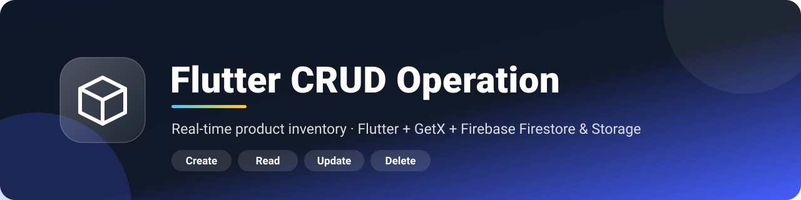

<div align="center">



<h3>A polished, real-time product inventory app built with Flutter, GetX and Firebase.</h3>

<p>
  <a href="https://github.com/SirAseef/Flutter-Crud-Operation/actions/workflows/ci.yml"></a>
  
  
  
  
  
  <a href="LICENSE"></a>
</p>

<p>
  <a href="#-features">Features</a> •
  <a href="#-architecture">Architecture</a> •
  <a href="#-getting-started">Getting started</a> •
  <a href="#-screenshots">Screenshots</a> •
  <a href="#-roadmap">Roadmap</a> •
  <a href="#-author">Author</a>
</p>

</div>

---

> **Create, browse, search, edit and delete products — with photos — and watch every change sync instantly across devices through Cloud Firestore.**

## ✨ Features

| | Feature | Details |
|---|---|---|
| ➕ | **Create** | Name, description, category, SKU, price, stock quantity and availability, with form validation |
| 🖼️ | **Product photos** | Pick from the gallery (auto-compressed, uploaded to Firebase Storage) **or** paste a public image URL |
| ⚡ | **Real-time list** | Firestore `snapshots()` stream — adds, edits and deletes appear instantly, no refresh |
| 🔎 | **Instant search** | Case-insensitive filtering across name, description, category and SKU |
| ✏️ | **Update** | Edit any field or swap the photo; the original `createdAt` is preserved and the old image is cleaned up |
| 🗑️ | **Delete** | Confirmation dialog; removes the Firestore document **and** its Storage image |
| 📱 | **Responsive UI** | 1/2/3-column grid, adaptive FAB and two-column form on wide screens — phone, tablet and desktop/web |
| 🌗 | **Light & dark themes** | Material 3 theme generated from a single seed colour, toggled from the app bar |
| 🛡️ | **Graceful failure** | App still launches without Firebase config and shows a clear *Setup needed* / *Connection issue* status; network calls have timeouts and roll back orphaned uploads |
| 🎬 | **Animated splash** | Branded gradient splash screen with a scale-in animation |

## 🧰 Tech stack

| Layer | Technology |
|---|---|
| UI | Flutter · Material 3 |
| Language | Dart 3 |
| State management & routing | [GetX](https://pub.dev/packages/get) (`GetxController`, `.obs`, `Obx`, named routes) |
| Database | [Cloud Firestore](https://pub.dev/packages/cloud_firestore) (real-time streams) |
| File storage | [Firebase Storage](https://pub.dev/packages/firebase_storage) |
| Media | [image_picker](https://pub.dev/packages/image_picker) |
| Quality | `flutter_lints` + extra rules · widget & unit tests · GitHub Actions CI |

## 🏗️ Architecture

The app follows a simple, layered architecture: **Views** render state and forward user intent, **Controllers** own reactive state, the **Service** is the only layer that talks to Firebase, and the **Model** maps Firestore documents into immutable Dart objects.

```mermaid
flowchart LR
    subgraph UI["🖥️ Views (lib/views)"]
        S[SplashPage]
        H[HomePage<br/>dashboard · search · grid]
        F[ProductFormPage<br/>create / edit]
        V[ProductViewPage<br/>details · delete]
    end

    subgraph State["🧠 State — GetX (lib/controllers)"]
        PC[ProductController<br/>products.obs · searchText.obs<br/>isLoading · connectionStatus]
        AC[AppController<br/>isDarkMode.obs]
    end

    subgraph Data["🔌 Data (lib/services + lib/models)"]
        PS[ProductService]
        M[Product model]
    end

    subgraph Firebase["☁️ Firebase"]
        FS[(Cloud Firestore<br/>items collection)]
        ST[(Firebase Storage<br/>items/&#123;id&#125;/…)]
    end

    H -- Obx --> PC
    F -- saveItem --> PC
    V -- deleteItem --> PC
    H -- toggleTheme --> AC
    PC --> PS
    PS -- "snapshots() stream" --> FS
    PS -- "set(merge) / delete" --> FS
    PS -- "putData / delete" --> ST
    FS -. "real-time updates" .-> PS
    PS -. "List&lt;Product&gt;" .-> PC
    PS --- M
```



**Save flow:** form validates → `ProductController.saveItem` → `ProductService.saveProduct` uploads the image (if any, 60 s timeout) → writes the document with `merge: true` and server timestamps → deletes the replaced image → the Firestore stream pushes the updated list back to every listening screen.

## 🗂️ Data model

Documents live in the Firestore collection **`items`** (document ID = product ID).

| Field | Type | Notes |
|---|---|---|
| `name` | `string` | Required, trimmed |
| `description` | `string` | Optional |
| `category` | `string` | `Other` · `Electronics` · `Fashion` · `Home` · `Books` · `Food` |
| `sku` | `string` | Optional product code |
| `price` | `number` | ≥ 0 |
| `quantity` | `number` (int) | ≥ 0 |
| `status` | `string` | `Available` · `Out of stock` · `Coming soon` |
| `imageUrl` | `string` | Storage download URL or external image link |
| `imagePath` | `string` | Storage object path; empty for external links |
| `createdAt` | `timestamp` | Server time, set on create only |
| `updatedAt` | `timestamp` | Server time, set on every save |

Uploaded photos are stored at `items/{productId}/{timestamp}_{fileName}` in Firebase Storage.

## 📁 Project structure

```text
lib/
├── main.dart                     # Firebase init, GetX controller registration, routes
├── app_theme.dart                # Material 3 light/dark themes from one seed colour
├── firebase_options.dart.example # Template — real file is generated & git-ignored
├── controllers/
│   ├── app_controller.dart       # Theme mode state
│   └── product_controller.dart   # Product list, search, loading/error, CRUD actions
├── models/
│   └── product.dart              # Immutable Product + Firestore mapping
├── services/
│   └── product_service.dart      # All Firestore & Storage access
└── views/
    ├── splash_page.dart          # Animated splash
    ├── home_page.dart            # Dashboard, search, responsive product grid
    ├── product_form_page.dart    # Create / edit form with photo picker
    └── product_view_page.dart    # Product details, edit & delete
test/
├── widget_test.dart              # Navigation, form & responsive-layout widget tests
└── product_controller_test.dart  # Search/filter & setup-state unit tests
.github/                          # CI workflow, issue & PR templates
docs/assets/                      # README artwork
```

## 🚀 Getting started

### Prerequisites

- [Flutter SDK](https://docs.flutter.dev/get-started/install) (latest **stable**; Dart version per [`pubspec.yaml`](pubspec.yaml))
- A [Firebase](https://console.firebase.google.com/) project with **Cloud Firestore** and **Firebase Storage** enabled
- Android emulator/device, iOS simulator (macOS + Xcode), or Chrome

### 1 — Clone & install

```bash
git clone https://github.com/SirAseef/Flutter-Crud-Operation.git
cd Flutter-Crud-Operation
flutter pub get
```

### 2 — Connect your Firebase project

Firebase client config is **never committed**. Templates are provided instead:

| Template (committed) | Real file (git-ignored) |
|---|---|
| [`lib/firebase_options.dart.example`](lib/firebase_options.dart.example) | `lib/firebase_options.dart` |
| [`android/app/google-services.json.example`](android/app/google-services.json.example) | `android/app/google-services.json` |
| [`firebase.json.example`](firebase.json.example) | `firebase.json` |

**Recommended — generate them with FlutterFire:**

```bash
npm install -g firebase-tools        # once
firebase login
dart pub global activate flutterfire_cli
flutterfire configure                # pick your project + Android / iOS / Web
```

**Alternative — fill the templates by hand:**

```bash
cp lib/firebase_options.dart.example lib/firebase_options.dart
cp android/app/google-services.json.example android/app/google-services.json
cp firebase.json.example firebase.json
# then replace the YOUR_* placeholders with values from the Firebase Console
```

> ℹ️ The app won't compile until `lib/firebase_options.dart` exists. With placeholder values it still launches and shows **Setup needed** instead of crashing.

### 3 — Run

```bash
flutter devices          # list targets
flutter run              # default device
flutter run -d chrome    # web
```

When the dashboard chip shows **Connected**, tap **Add product** and start managing your catalogue.

### Quality checks & builds

```bash
flutter analyze          # static analysis (also run in CI)
flutter test             # widget + unit tests (also run in CI)

flutter build apk --release
flutter build web
flutter build ios        # macOS + Xcode signing required
```

## 📸 Screenshots

<!-- TODO: capture real screenshots (e.g. `flutter run -d chrome`, then save PNGs to docs/screenshots/) and replace the placeholders below. -->

| Splash | Dashboard | Add / edit product | Product details |
|:---:|:---:|:---:|:---:|
| _coming soon_ | _coming soon_ | _coming soon_ | _coming soon_ |

| Dark mode | Search | Tablet / web layout |
|:---:|:---:|:---:|
| _coming soon_ | _coming soon_ | _coming soon_ |

## 🔐 Security

- `firebase_options.dart`, `google-services.json`, `GoogleService-Info.plist` and `firebase.json` are **git-ignored**; only `.example` templates live in the repo.
- Firebase client keys identify your project but **do not protect data** — use restrictive **Firestore** and **Storage Security Rules**, and add **Firebase Authentication** / **App Check** before production. Never ship open test-mode rules.
- Restrict API keys in Google Cloud Console (by package / bundle ID or HTTP referrer, and to the Firebase APIs you use).

Found a vulnerability? Please follow [SECURITY.md](SECURITY.md) and report it privately.

## 🛣️ Roadmap

- [ ] Firebase Authentication with per-user product ownership
- [ ] Production-ready Firestore & Storage security rules in the repo
- [ ] Sorting and category / status filters
- [ ] Pagination for large catalogues
- [ ] Currency & locale-aware price formatting
- [ ] Offline-first indicators and retry queue
- [ ] Low-stock alerts and inventory insights
- [ ] Live web demo via Firebase Hosting
- [ ] Real screenshots and a short demo GIF

## 🤝 Contributing

Contributions are welcome! Please read [CONTRIBUTING.md](CONTRIBUTING.md), open an issue to discuss bigger changes, and make sure `flutter analyze` and `flutter test` pass before opening a pull request.

## 📄 License

Released under the [MIT License](LICENSE) © 2026 Aseef Ahmed.

## 👤 Author

<table>
  <tr>
    <td>
      <strong>Aseef Ahmed</strong><br/>
      Founder, <strong>Alpha Group</strong> · Software Engineer & Data Scientist<br/><br/>
      <a href="https://github.com/SirAseef"></a>
      <a href="https://www.linkedin.com/in/aseef-ahmed-6ab6b7196"></a>
      <a href="mailto:aseefahmed@aptechnorth.edu.pk"></a>
    </td>
  </tr>
</table>

<div align="center">

If this project helped you, consider giving it a ⭐ — it really helps!

</div>
